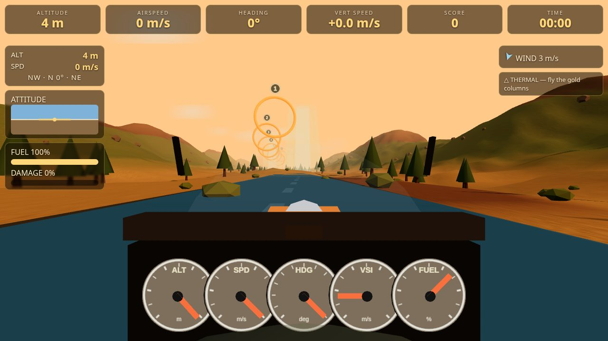
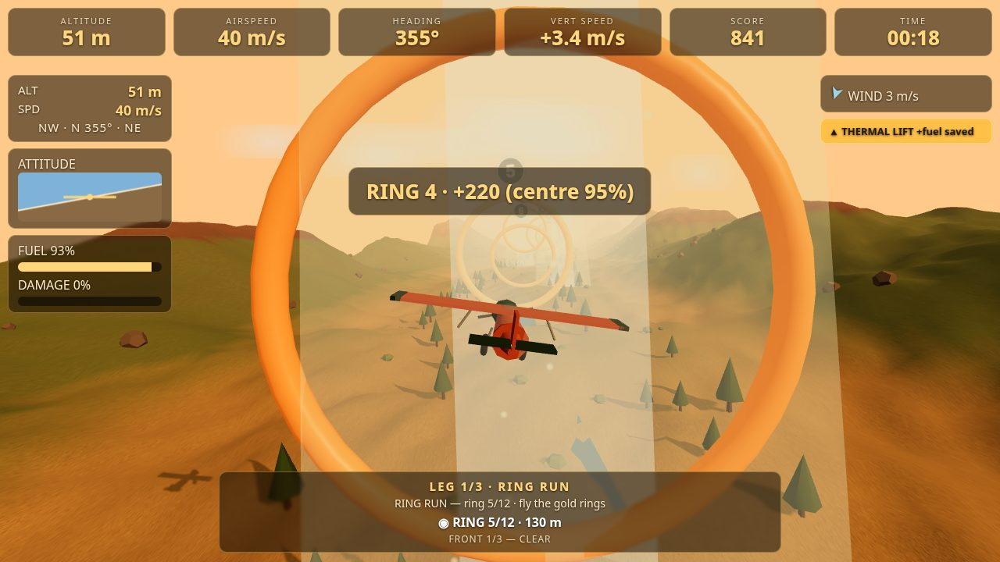
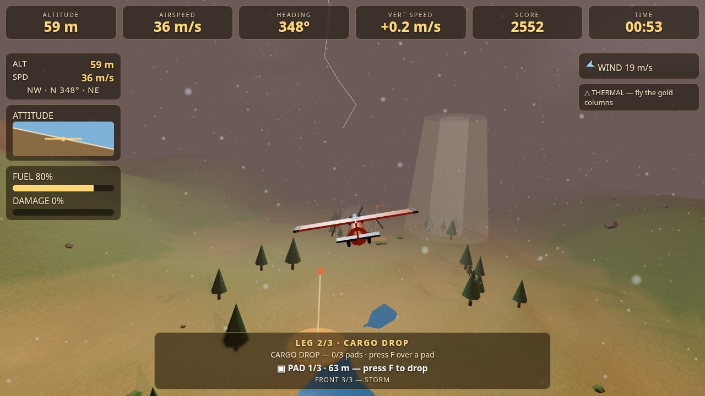
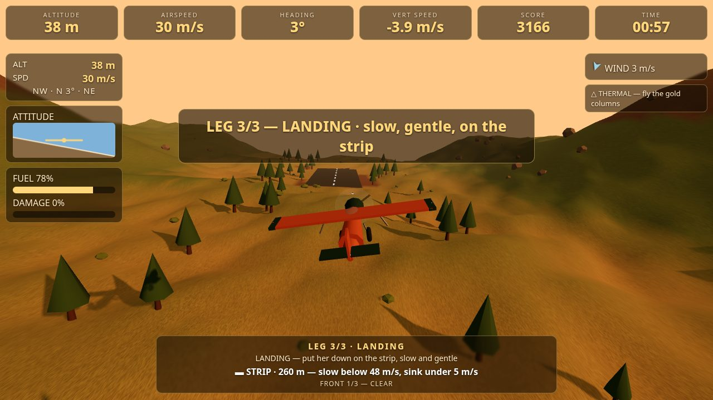

# Canyon Courier: 12 rings, 3 weather fronts, 2 aircraft, 3-leg ThermalWind loop

**Canyon Courier** is a complete 3D flight game (Three.js, vendored, zero network): one sortie down Ember Canyon in a bush plane. **Leg 1 — Ring Run:** thread 12 gold rings, scored on centre accuracy and speed. **Leg 2 — Cargo Drop:** release 3 supply packs over the orange pads (F). **Leg 3 — Landing:** put her down on the short strip, slow and gentle. **ThermalWind** is the named weather system: three fronts (clear / strong wind / storm) roll through the sortie while gold thermal columns give free lift — ride one and you save fuel, fight the storm and you burn it. Two aircraft (Bush Courier, forgiving and thrifty; Swift Courier, 10 m/s faster and thirstier), a golden-hour canyon with river, pines and clouds, a lit 3D cockpit with five working dials, chase + cockpit cameras, procedural WebAudio engine/wind/chimes, and fuel + damage that turn every sortie into decisions.

Run it: `node serve.ts` then open http://localhost:8080 — W/S throttle, arrows/A-D pitch and roll, Q/E rudder, Space air brake, F drop cargo, C camera, P pause, R restart, T weather, M mute. Verify it: `node tools/playtest.mjs` (one full sortie), `node tools/shots.mjs` (4 deterministic screenshots), `node tools/soak.mjs 10` (10 sorties).

## Screenshots (real renders of the final build, 1280×720)

| Cover — cockpit on the runway | Ring run — through ring 4 |
|---|---|
|  |  |
| Storm — rain, lightning, 19 m/s wind | Landing — final approach to the short strip |
|  |  |

## Score formula

| Leg | Formula | Max |
|---|---|---|
| Ring Run (12 rings) | per ring `100 + 100 × centre accuracy + 50 × (speed ÷ 80)`, centre accuracy `1 − dist ÷ 20 m`; missed ring 0 | 3,000 |
| Cargo Drop (3 pads) | per pad `150 + 100 × (1 − drop dist ÷ 70 m)` | 750 |
| Landing | `300 × (0.35 × speed score + 0.35 × sink score + 0.30 × centre score)`; speed ≤ 48 m/s, sink ≤ 5 m/s, on the strip (just off = half) | 300 |
| **Total** | rings + cargo + landing → rank S ≥ 3,200 · A ≥ 2,600 · B ≥ 1,800 · C ≥ 1,000 · D below | **4,050** |

Fuel: 100% at takeoff, throttle burns it, riding a gold thermal halves the burn. Damage: rough touchdowns and canyon scrapes add up; 100% ends the sortie.

## Changelog

- v2: cover fixed (translucent prop + blur disc, slim windshield posts, nose cowling visible over the panel); real storm (1,400-drop slanting rain, lightning bolt + flash, grey clouds, HUD wind now the front's configured 19 m/s, gust floor 0.75×); shadows on (PCFSoft sun shadow following the plane, terrain + pines receive/cast); thermals readable (2.2× more opaque columns + bright core + rising gold motes); storm shot reframed (wider chase, flown past ring 12, banner cleared, flash forced); README screenshots + score table.
- v1: first full build — 12-ring / 3-pad / strip sortie, ThermalWind fronts + thermals, 2 aircraft, golden-hour canyon, lit cockpit dials, procedural audio, tools/ (playtest + shots + soak).
